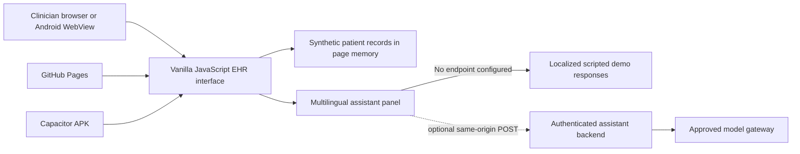
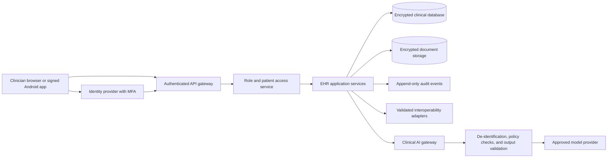

# Wellnest Clinical Architecture

## Current Demo



The current GitHub Pages and Android builds serve the same bundled UI. Patient data, notes, order updates, and assistant conversation are synthetic and held in memory; they are not synchronized or persisted. The assistant supports English, Spanish, French, Hindi, and Arabic UI text. Its default responses are scripted chart summaries, not generated by an AI model.

## Assistant Endpoint Contract

Set `VITE_CLINICAL_ASSISTANT_ENDPOINT` to a same-origin endpoint only after the server is ready. The client sends:

```json
{
  "message": "Summarize this chart",
  "locale": "en",
  "patient": {
    "mrn": "NL-004281",
    "name": "Synthetic Patient",
    "reason": "Synthetic visit reason",
    "allergies": "Synthetic allergy data",
    "medications": [],
    "recentHistory": [],
    "encounterNote": ""
  }
}
```

The endpoint returns `{"reply":"..."}`. The browser does not call a model provider directly. The backend must authenticate the clinician, authorize access to the requested patient, validate and minimize context, audit access, apply retention controls, and restrict model output to assistive summaries. The endpoint must not be enabled for real patient data until security, privacy, clinical governance, and applicable compliance reviews are complete.

## Production Target



The production design is a target, not implemented infrastructure. It requires server-side authorization on every patient request, tenant isolation, encryption in transit and at rest, key management, backups and restore testing, audit review, incident response, data retention controls, interoperability validation, and clinical safety oversight. An AI response must never be treated as a diagnosis, prescription, or substitute for clinician judgment.